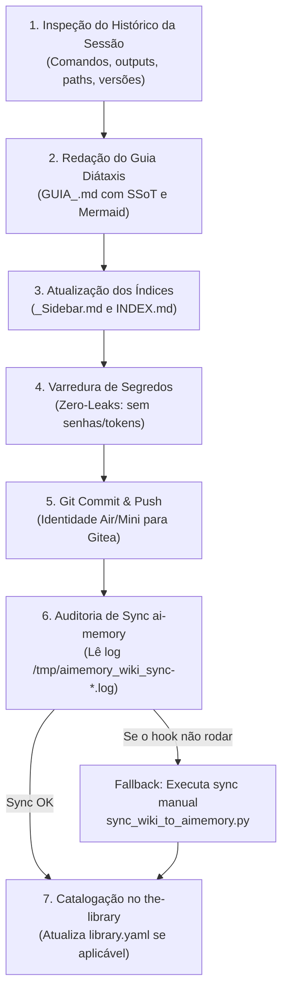

# 📖 Skill: guia-wiki-creator (Gerador Automático de Guias SSoT na Wiki)

Esta skill define o protocolo operacional determinístico para agentes da **Squad Antigravity** documentarem ferramentas, bibliotecas, daemons e capacidades homologadas na sessão, integrando-as à **Wiki Central (`usit-developer-guide.wiki`)**, ao índice semântico do **`ai-memory`** e ao catálogo corporativo **`the-library`**.

---

## 🎯 1. Quando Ativar esta Skill

Ative esta skill sempre que:
1. Uma ferramenta, CLI, biblioteca ou skill acabar de ser instalada, configurada e validada com sucesso na sessão (ex: Archify, CodeMender, Just, etc.).
2. O usuário solicitar: `crie um guia na wiki`, `/guia-wiki-creator`, `documente essa ferramenta na wiki`, `adicione na wiki`, `atualize a wiki com o que fizemos`.
3. Houver necessidade de padronizar e registrar uma nova capacidade técnica como Fonte Única da Verdade (SSoT) compartilhada entre **MacBook Air** e **Mac Mini**.

---

## 🧭 2. Protocolo de Execução em 7 Etapas (Zero-Mock)

O agente deve executar rigorosamente o seguinte fluxo sequencial:



---

### Etapa 1: Inspeção do Histórico da Sessão & Extração de Evidências

Antes de redigir qualquer linha, o agente DEVE coletar evidências empíricas da sessão atual:
1. **Comandos Executados**: Quais comandos foram usados para instalar, configurar e validar a ferramenta (ex: `npx skills add`, `brew install`, `pip install`, `make`, etc.).
2. **Binários e Symlinks**: Localização física do executável (ex: `~/.local/bin/<ferramenta>`) e versão exata (`<ferramenta> --version` ou `<ferramenta> doctor`).
3. **Paths de Configuração**: Onde residem arquivos de configuração, skills, schemas e exemplos (ex: `~/.gemini/config/skills/`, `~/.agents/skills/`, `~/.config/`).
4. **Evidência Real de Validação**: O output real do teste de homologação (ex: teste de renderização, compilação ou execução de prova de conceito).

---

### Etapa 2: Redação do Guia no Padrão Diátaxis (`GUIA_<FERRAMENTA>.md`)

Crie o arquivo `/Users/romuloigor/Local/usit-developer-guide.wiki/GUIA_<NOME_EM_MAIUSCULAS>.md` seguindo o template corporativo:

```markdown
---
id: GUIA_<NOME>
title: Guia de <Operação/Arquitetura>: <Nome da Ferramenta> (<Subtítulo Conciso>)
category: how-to
tags: [<ferramenta>, <tags-relevantes>, architecture, cli, antigravity]
last_updated: <AAAA-MM-DD>
---

# Guia de <Operação/Arquitetura>: <Nome da Ferramenta>

Breve introdução explicando o propósito corporativo da tecnologia na Squad Antigravity.

---

## 📌 1. Visão Geral: Por que o Squad usa <Ferramenta>?
- Problema concreto que a ferramenta resolve no squad.
- Comparação com abordagens legadas ou manuais.
- Diagrama conceitual em Mermaid demonstrando a integração.

---

## 🧭 2. Arquitetura & Modos de Operação
- Visão estrutural de componentes, tipos ou submódulos.
- Modos suportados (ex: CLI, local, nuvem, plugins).

---

## ⚡ 3. Instalação e Disponibilidade no Ambiente Corporativo
- Caminho dos binários no PATH (`~/.local/bin/`).
- Disponibilidade no MacBook Air e no Mac Mini.
- Mapeamento de skills e slash commands associados no Antigravity.

---

## 🛠️ 4. Guia Rápido de Comandos da CLI
Tabela ou blocos de código com os comandos mais comuns, flags recomendadas e suas saídas esperadas baseadas no teste real realizado na sessão.

---

## 📝 5. Exemplos de Configuração / Schemas Prontos
Exemplos práticos, limpos e prontos para copiar e colar em novos projetos.

---

## 🛡️ 6. Boas Práticas e Regras de Ouro (Zero-Mock)
Regras inegociáveis do squad para uso correto da ferramenta (ex: versionamento, fail-on gates, segurança).
```

---

### Etapa 3: Atualização dos Índices de Navegação da Wiki

Edite os seguintes arquivos centrais:
1. **`/Users/romuloigor/Local/usit-developer-guide.wiki/_Sidebar.md`**:
   - Adicione o link sob a categoria correta (geralmente `### 🛠️ Guias de Tecnologias & Ferramentas`):
     ```markdown
     * [Guia <Nome> (<Descrição Curta>)](GUIA_<NOME>)
     ```
2. **`/Users/romuloigor/Local/usit-developer-guide.wiki/INDEX.md`**:
   - Adicione na subseção correspondente da **Matriz Diátaxis** (`### 🛠️ B. How-To Guides`):
     ```markdown
     * 📊 **[GUIA_<NOME>](GUIA_<NOME>):** <Resumo em 1-2 linhas>.
     ```
   - Adicione uma linha na **Matriz de Busca e Indexação para Agentes de IA (`## 🔍 4. Matriz de Busca`)**:
     ```markdown
     | `<tag1>` / `<tag2>` / `<tag3>` | <Escopo Técnico> | [GUIA_<NOME>](GUIA_<NOME>) |
     ```

---

### Etapa 4: Auditoria de Segurança Pré-Commit (Zero-Leaks)

Antes de qualquer `git add`, execute varredura de segurança nos arquivos alterados:
```bash
grep -nEi "(token|password|senha|api[_-]?key|secret)[^|]{0,10}[:=] *['\"][A-Za-z0-9_\-]{20,}" GUIA_<NOME>.md || echo "Zero leaks detectado"
```
Nenhum token ou chave real pode ser commitado.

---

### Etapa 5: Git Commit & Push com Identidade Determinística

1. **Verifique o Hostname**:
   - `romuloigor-air` ➔ `git config user.name "Antigravity Air" && git config user.email "antigravity-bot-air@local.gitea"`
   - `romuloigors-mini` ➔ `git config user.name "Antigravity Mini" && git config user.email "antigravity-bot-mini@local.gitea"`
2. **Commit e Push**:
   ```bash
   git -C /Users/romuloigor/Local/usit-developer-guide.wiki add GUIA_<NOME>.md _Sidebar.md INDEX.md
   git -C /Users/romuloigor/Local/usit-developer-guide.wiki commit -m "docs(<nome>): adiciona GUIA_<NOME> e registra no INDEX e _Sidebar"
   git -C /Users/romuloigor/Local/usit-developer-guide.wiki push origin main
   ```

---

### Etapa 6: Auditoria & Garantia de Sincronização com o `ai-memory`

O hook `post-commit` da Wiki dispara um sync em background que grava logs com timestamp de milissegundos em `/tmp/aimemory_wiki_sync-<TS>.log`.

O agente DEVE validar o efeito real da sincronização:
1. **Aguardar e inspecionar o log mais recente**:
   ```bash
   sleep 4
   LOG_FILE=$(ls -t /tmp/aimemory_wiki_sync-*.log 2>/dev/null | head -1)
   ```
2. **Monitorar até a conclusão**:
   - Aguarde até 25s verificando se a última linha contém:
     `🏁 Sincronização concluída: <N>/<N> páginas indexadas com sucesso.`
3. **Fallback Explícito (Zero-Mock)**:
   - Se o hook não tiver disparado ou o log indicar falha de socket/timeout:
     ```bash
     python3 /Users/romuloigor/Local/local-ai-memory/scripts/sync_wiki_to_aimemory.py
     ```
4. **Verificação de Recuperação Semântica**:
   - Teste a recuperação real executando:
     ```bash
     ai-mem-wiki "<termo-chave-da-nova-ferramenta>"
     ```
   - Confirme se `GUIA_<NOME>` aparece nos resultados retornados.

---

### Etapa 7: Catalogação no `the-library` (se aplicável)

Se a ferramenta instalada for uma **Skill** corporativa ou possuir scripts associados:
1. Verifique se a skill existe em `/Users/romuloigor/Local/the-library/skills/<nome>/` ou se é referenciada externamente.
2. Atualize `/Users/romuloigor/Local/the-library/library.yaml` adicionando o ponteiro e a descrição em `library.skills`.
3. Se houver hooks associados (ex: git hooks reutilizáveis), registre-os na seção `library.hooks` e salve o template em `/Users/romuloigor/Local/the-library/hooks/`.

---

## 🏁 3. Definition of Done (DoD)

Uma execução do `guia-wiki-creator` só é considerada concluída quando:
- [x] O arquivo `GUIA_<FERRAMENTA>.md` está redigido, formatado e salvo na Wiki.
- [x] `_Sidebar.md` e `INDEX.md` estão atualizados.
- [x] O commit foi realizado com identidade correta (`Antigravity Air` ou `Mini`) e enviado ao Gitea (`main...origin/main` limpo).
- [x] O log `/tmp/aimemory_wiki_sync-*.log` comprovou indexação de 100% das páginas.
- [x] Uma busca via `ai-mem-wiki` retornou o novo guia com sucesso.
- [x] O catálogo `the-library` foi atualizado se uma nova skill ou hook fez parte da entrega.
